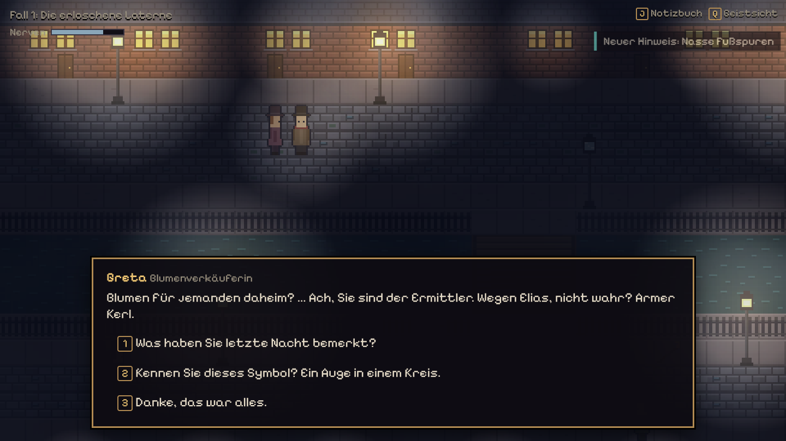
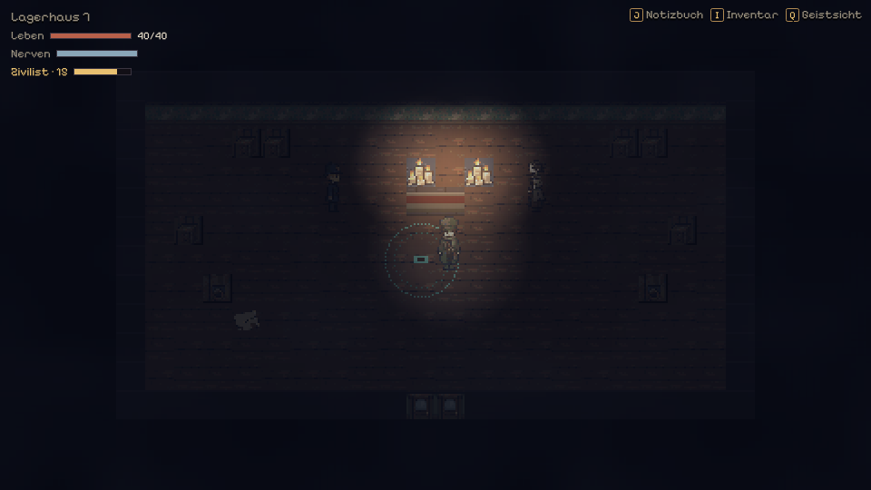
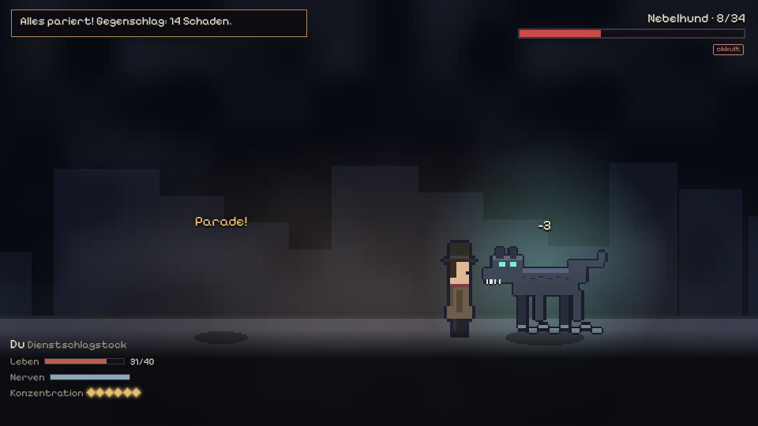
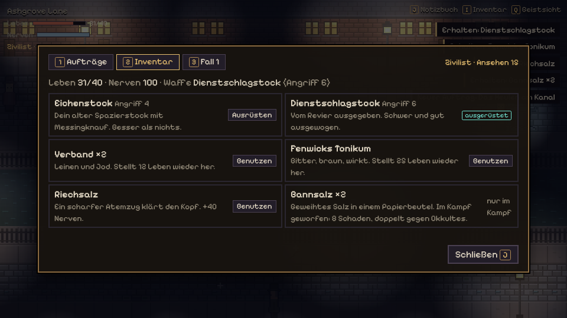
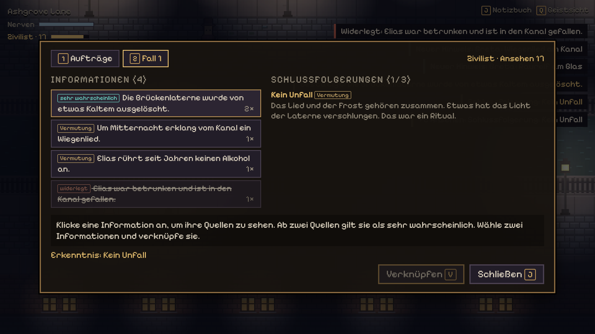
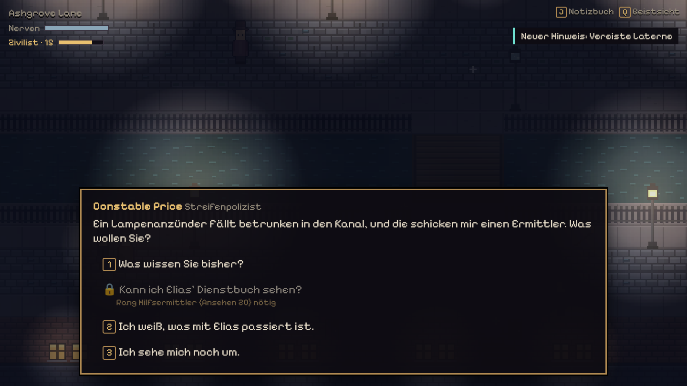

# Nebelakten

Ein 2D-Pixel-Mystery im Browser: Top-down wie ein Farm-/Life-Sim, aber düster.
Nebel, Gaslaternen, eine viktorianisch-okkulte Großstadt. Im Mittelpunkt stehen
Ermitteln, Gespräche und das Verknüpfen von Hinweisen, nicht Kämpfe.



**Stand:** spielbarer Prototyp mit vier zusammenhängenden Fällen, zweiundzwanzig Nebenaufträgen,
fünfzehn Orten (Polizeirevier, Ashgrove Lane mit Hinterhof, Taverne „Zum Ertrunkenen Mond“, Altmarkt,
Nachtmarkt, Friedhof St. Ebba, Krypta, Kanalhafen, Lagerhaus 7, Nordtor-Viertel, Lumen-Theater, Uhrturm,
alte Gaskanäle, Schlachthof, Sternwarte am Krater), Inventar, Leben,
einem kleinen Rundenkampf mit Timing und Spielständen.

## Spielen

**Online:** https://wuerfelduell.github.io/Dnd/
(wird bei jedem Push auf `main` automatisch neu gebaut, siehe unten „Deployment“).

**Lokal am Laptop:**

1. [Node.js](https://nodejs.org) (Version 20 oder neuer) installieren.
2. Im Projektordner einmalig `npm install` ausführen.
3. `npm run dev` starten und die angezeigte Adresse öffnen (http://localhost:5173).
   Änderungen am Code oder an den Falldaten erscheinen sofort im Browser.

## Steuerung

| Taste | Wirkung |
|---|---|
| `WASD` / Pfeiltasten | laufen |
| `E` | untersuchen, sprechen, weiter |
| `1`–`9` oder Klick | Antwort im Gespräch wählen |
| `Q` | Geistsicht an/aus: zeigt verborgene Spuren, kostet Nerven |
| `J` / `Tab` | Notizbuch: zwei Hinweise anklicken, mit `V` verknüpfen |
| `I` | Inventar: Gegenstände benutzen, Waffe ausrüsten, Tränke trinken |
| `P` | Pfad: Sequenz, Verdauung, Unruhe, Fähigkeiten und Formeln |
| Kampf: `1`–`4` | Aktion wählen (Angriff, Fertigkeiten, Gegenstände, Flucht) |
| Kampf: `E` / `Leertaste` | beim Angriff im goldenen Bereich drücken |
| Kampf: `Leertaste` / `F` | beim gegnerischen Schlag ausweichen / parieren |
| `R` | nach einem Ende neu starten |
| `Esc` | Menü: Spieler 2 hinzufügen oder entfernen |

### Zu zweit an einem Rechner

Im `Esc`-Menü kommt Spieler 2 dazu (und geht wieder). Beide laufen über denselben Bildschirm, die Kamera hält
die Mitte zwischen euch, und niemand kann dem anderen aus dem Bild laufen. Spieler 2 hat eigenes Leben, eigene
Nerven, ein eigenes Inventar und eine eigene Waffe; Geld, Ansehen, Fälle und der Pfad gehören dem Ermittler.
Beweisstücke wandern immer zum Ermittler. Wer geht, behält seine Sachen für das nächste Mal.

| Spieler 2 | Wirkung |
|---|---|
| Pfeiltasten / Gamepad-Stick | laufen (zu zweit läuft Spieler 1 nur mit `WASD`) |
| `Enter` / Gamepad `A` | untersuchen, sprechen, Beute aufheben (landet in seiner Tasche) |
| `I`, dann `G` / Gamepad `Y` | eigenes Inventar; `→ Sp. 1` gibt etwas weiter |
| `G` im Laden oder Lager | zwischen den Taschen beider Spieler wechseln |
| Kampf: `1`–`4` | Aktion wählen, wenn Spieler 2 am Zug ist (Gamepad `A` = Angriff) |
| Kampf: `Enter` / Gamepad `A` | Takt beim eigenen Angriff |
| Kampf: `←` / `→` (Gamepad `X` / `B`) | ausweichen / parieren, wenn der Gegner Spieler 2 angreift |

Im Kampf stehen beide nebeneinander. Jede Runde handelt erst Spieler 1, dann Spieler 2, dann greift der Gegner
einen von beiden an; abwehren muss der Angegriffene mit seinen Tasten. Jeder hat eigene Konzentration, eigene
Gegenstände und eigene Zustände (Schutz, Blutung). Wer zu Boden geht, setzt aus; verloren ist erst, wenn beide
liegen. Gewinnt der andere, rappelt sich der Gestürzte mit einem Viertel seines Lebens auf.

## Spielmechanik

### Beziehungen (drei Stimmungen je Figur)

Jede Figur merkt sich, wie man sie behandelt hat, als **Beziehungswert** (−5 bis +6) und zeigt daraus eine von drei
Stimmungen: **feindselig** (ab −2), **neutral**, **freundlich** (ab +3). Die Stimmung steht als Abzeichen neben dem Namen
im Gespräch und im Notizbuch unter „Personen“, färbt das Portrait (Lächeln oder Misstrauen) und bringt einen eigenen
Begrüßungssatz. Der Wert ändert sich durch Gesprächsentscheidungen und Aufträge (`relation` an Dialogknoten oder
Auftragsbelohnungen, Knoten wirken nur beim ersten Besuch), durch **Geschenke** („Etwas schenken …“ im Menü jeder Figur:
jede Figur hat ein Auge für zwei Arten von Dingen, das Fenster zeigt sie; Gemochtes und Wertvolles ab 12 Schilling zählt bis zu
dreimal, Verabscheutes kostet, Billiges wird mit einem Hinweis auf den Wunsch abgelehnt) und durch einen Kampf im Gespräch
(macht sofort feindselig).
Freundliche Händler geben 10 % Nachlass, feindselige schlagen 20 % auf; Gesprächsoptionen können eine Stimmung verlangen
(`requires_mood`, `requires_relation`). Einzelgänger und Gefährten behalten ihren Vertrauenswert, er zählt hier mit.
Zu zweit gehört die Beziehung dem Ermittler, beide Spieler wirken auf sie. Daten: `src/data/beziehungen.json`, Pakete
können `beziehungen` mitbringen.

### Pfade und Tränke (Nachtmarkt)

Auf dem **Nachtmarkt** unter der Krähenbrücke (Stadtkarte) kann man aufsteigen:

- **Sieben Pfade**, je mit Sequenz 9, 8 und 7: Laterne (Licht, Feuer, gegen Okkultes), Faden (Wahrsagen, Analyse),
  Maske (Illusion, Täuschung), Echo (Geister, Klang), Kessel (Heilen, Gift), Eisen (Kraft, Paraden), Schlüssel (Schleichen, Fallen).
  Jede Sequenz bringt eine **Kampffähigkeit** (im Kampf unter Fertigkeiten, mit ✧ markiert) und passive Boni.
- **Formel** bei Cornelius Kittering kaufen, **Zutaten** bei Nell Rauhfuß, am **Braukessel** brauen, im Inventar **trinken**.
- **Verdauen**: Jeder Pfad hat einen Grundsatz. Wer danach handelt (Faden: Schlussfolgerungen ziehen, Eisen: Kämpfe gewinnen,
  Schlüssel: gesperrte Akten öffnen, ...), verdaut den Trank. Erst bei 100 % verträgt man die nächste Sequenz gefahrlos.
  Die Verdauung steht im HUD, jede passende Handlung meldet sich mit „+N % verdaut“, und die Pfad-Seite (`P`) listet,
  welche Handlungen den eigenen Pfad wie stark verdauen.
- **Unruhe**: kommt mit jedem Trank und mit Geistsicht, klingt mit der Zeit und durch passendes Handeln ab. Ruhetee senkt sie.
  Bei 100 Unruhe oder einem zu früh getrunkenen Trank droht der **Kontrollverlust**: Ohnmacht, Verlust von Leben,
  Schilling und Verdauung (nie Game Over).
- **Schilling** gibt es für Aufträge, Fallenden, besiegte Gegner und den Verkauf beim Pfandleiher Gorse.
  In Brocks **Kampfgrube** kann man um Geld kämpfen, Sabeths **Schattenpuppe** ist ein Übungskampf für die neuen Fähigkeiten.
- Inhalte: `src/data/pathways.json` (Pfade, Zutaten) und `src/data/market.json` (Händler, Preise, Beute).

- **Hinweise** findest du in der Welt (funkelnde Stellen) oder in Gesprächen.
  Jeder Hinweis ist eine **Quelle** für eine **Information**.
- **Nicht alles ist wahr**: Eine Information mit einer Quelle ist nur eine
  *Vermutung*. Erst ab **zwei unabhängigen Quellen** gilt sie als *sehr wahrscheinlich*.
  Auch die Polizei liegt manchmal falsch; solche Infos werden durch Gegenbeweise *widerlegt*.
- Im Notizbuch steht bei jeder Quelle, **woher** sie stammt: das Gesicht der Person, die es erzählt hat,
  dein eigenes bei Beobachtungen, sonst ein Symbol für Gelesenes, Akten, Polizeiberichte oder Geistsicht.
- **Fundstücke untersuchen**: Manche Gegenstände (Gesangbuch, Glocke, Stimmphiole, Sternglas,
  Spiegelscherbe) lassen sich im Inventar untersuchen. Das kann Bonus-Hinweise bringen, kostet aber
  Nerven oder Unruhe, kann verletzen oder einen Kampf auslösen. Ruhige Nerven senken das Risiko.
- **Verknüpfen**: Im Notizbuch kombinierst du zwei Informationen zu einer
  **Schlussfolgerung**. Sie ist *gesichert*, wenn beide Informationen sehr wahrscheinlich sind.
  Für eine Auflösung wollen Price und Marlowe gesicherte Schlussfolgerungen sehen.
- Gelöste Fälle wandern ins **Archiv** (eigener Reiter, alte Informationen bleiben lesbar). Der Reiter **Personen** listet alle,
  mit denen du gesprochen hast, mit Gesicht, Ort und laufenden Aufträgen. Erledigte Aufträge sind zusammengeklappt.
- **Rat holen**: Frag Inspektorin Marlowe im Revier („Haben Sie einen Rat?“). Sie sagt konkret, was als Nächstes ansteht,
  wo du nachsehen und wen du fragen sollst, welche Vermutung noch eine zweite Quelle braucht und was sie selbst noch
  sehen will, bevor sie einen Fall abschließt.
- **Ansehen bei der Polizei**: Gelöste Fälle, gestellte Gauner und Nebenaufträge bringen
  Ansehen, falsche Beschuldigungen kosten es. Fünf Ränge (Zivilist, Hilfsermittler,
  Ermittler, Vertrauter des Reviers, Geachteter Ermittler) öffnen Archivakten,
  Dienstbücher und Gesprächsoptionen, die zusätzliche Quellen und Abkürzungen liefern.
  Gesperrte Optionen sieht man ausgegraut mit dem nötigen Rang. Manche Leute (Häftlinge)
  reden dafür *weniger*, je angesehener du bist.
- **Geistsicht** macht okkulte Spuren sichtbar. Sie zehrt an den **Nerven**.
- **Leben und Inventar**: Verbände und Tonikum heilen, Riechsalz beruhigt die Nerven,
  Bannsalz hilft gegen Okkultes. Die Pritsche im Revier heilt vollständig. Bessere Waffen
  gibt es mit höherem Rang (Dienstschlagstock ab Hilfsermittler, Stockdegen ab Vertrauter).
- **Kampf** ist selten und kurz, das Ermitteln bleibt im Vordergrund. Rundenbasiert mit Timing:
  Angriffe im richtigen Moment treffen präzise. Gegnerische Schläge kündigt ein schrumpfender
  Ring an: *Ausweichen* (Leertaste) ist großzügig, *Parieren* (F) eng, bringt aber Konzentration
  und einen Konter. Wer alle Schläge einer Attacke pariert, setzt zum Gegenschlag an.
  Konzentration bezahlt Fertigkeiten (Doppelschlag, Laternenblende, Bannwort).
  Wissen aus den Ermittlungen deckt Schwachstellen auf. Eine Niederlage ist kein Game Over:
  Man wacht mit wenig Leben wieder auf. Kämpfe bisher: Übungskampf mit Sergeant Holt,
  der Nebelhund am Kanal (Nebenauftrag), der Aschewächter in der Krypta (Fall 2), Ratten im Archiv,
  der Chor und Rook im Lagerhaus 7 (Fall 3), Silas der Falschspieler und der Spiegelschatten.
- **Stadtgegner und Kopfgelder:** Nach Fall 1 treiben sich Laternendiebe, Schmuggler, Nachtkrämer und
  Falschgeldpräger in den Vierteln herum, nach Fall 2 auch Rußgeister, Glockenhunde, Papierkrähen, Wachsmänner,
  Fadenspinnen und Nebelaale. Manchmal kommt eine Elite-Variante mit besserer Beute. Wer verliert, wacht im
  Revier auf und hat ein Zehntel seines Geldes verloren. Am Kopfgeld-Brett im Revier hängen Steckbriefe:
  „Funzel“ Moe Harker, Silas Penn, Dr. Quincy Vale und die Schmugglerkönigin Mag Ashdown. Die Königin legt
  nur an den Docks an, und wer vorher einen Schmuggler verhört, kennt ihre Schwachstelle.
- **Aufträge** stehen im Notizbuch mit abhakbaren Schritten. Der Spielstand wird
  automatisch im Browser gespeichert (Titelbildschirm: Fortsetzen / Neues Spiel).







## Geschichte bisher

1. **Die erloschene Laterne:** Der Lampenanzünder Elias Thorne verschwindet in Ashgrove Lane. Spur: Miriam Vey, ehemalige Chorleiterin von St. Ebba.
2. **Asche von St. Ebba:** Hester Marsh wird von einem Wiegenlied in die Krypta gelockt. Vey will ihre tote Tochter Lilian zurückholen.
3. **Der Chor singt woanders:** Jemand im Revier hilft Vey. Falsche Fährten führen zu Sergeant Holt, die Wahrheit zu Constable Rook und zum Lagerhaus 7 am Kanalhafen. Wer herausfindet, dass Vey noch die Glocke von St. Ebba braucht, kann ihr Ritual aufhalten.
4. **Die gestohlenen Stimmen:** Die Diva des Lumen-Theaters verliert über Nacht ihre Stimme, die Turmuhr am Nordtor schlägt um 3:33 drei falsche Töne. Der Polizeibericht beschuldigt den stummen Maskenmacher. Die Spur führt zum Souffleur Felix Dunmore, einst Veys Chorknabe, durch die alten Gaskanäle in den Uhrturm. Wer versteht, wie die Sternglas-Phiolen funktionieren, bringt die Stimmen heim.

Nebenaufträge: Taschendieb, verlegte Akte, Klopfen in der Zelle, Hesters Medaillon, Nebelhund, Die Uhr ohne Besitzer, Ratten im Archiv, Barnabys Unschuld (ein falscher Polizeibericht), Der Ertrunkene vom Kanalhafen (Geistsicht), Die Schlagzeile (eine Entscheidung mit Folgen fürs Ansehen).

Neu am Altmarkt und in der Taverne: **Gezinkte Würfel** (die Wirtin verdächtigt den Falschen), **Laternenrunde**
(vier vereiste Laternen neu anzünden), **Der Spiegel von Mr. Quill** (Geistsicht und ein okkulter Kampf),
**Was der blinde Ned hört** (ein Verband gegen Wissen), **Die schwarzen Kerzen** (nicht jeder Verdacht auf den Chor
stimmt) und **Gretas Stand** (ein korrupter Marktwart, drei Lösungswege). Wer genau hinsieht, merkt:
Veys Chor ist noch nicht ganz verstummt.

Am Nordtor: **Die Kröte im Kanal**, **Das Uhrwerk schweigt nicht**, **Der Maskenspieler** und **Leere Haken**
(zweimal ist der Lehrling Finn der bequeme Verdächtige) sowie **Gestohlenes Sternglas** in der Sternwarte.

Nach Fall 3: **Das verschwundene Gesangbuch**. Miss Pimm vermisst ein Asservat aus St. Ebba, Mr. Quill hat es
in der Vitrine. Man soll es nicht aufschlagen. Man kann es aber.

**Fall 5: Der Chor in der Glocke.** Sieben Sängerinnen aus Veys altem Chor sind verschwunden, und die
Glockengießerei Brannock am Kanal glüht. Price hält die Rostbrüder für schuldig. Hinweise gibt es in der
Gießerei, im Haus Vey in Ashgrove und bei alten Bekannten am Nordtor. Wer Uhrmacherin und Sternwarte fragt,
kann die Glocke brechen, statt sie nur zu zerschlagen. Endkampf gegen Miriam Vey in der Resonanzkammer.

**Fall 6: Der dreizehnte Gast.** Auf den Fotoplatten vom Ball der Ashcombes steht ein Fremder, und die
Abgelichteten werfen keinen Schatten mehr. Spuren führen ins Atelier Whitlock am Altmarkt und ins
Spiegelkabinett am Nordtor. Die Wahrsagerin ist die bequeme Verdächtige.

**Fall 7: Ertrunken im Trockenen** und **Fall 8: Die Schlafwandler von St. Brigid** beginnen gleichzeitig und
scheinen nichts miteinander zu tun zu haben: ein Bankier, der in seinem verschlossenen Kontor ertrunken ist, und
Waisenkinder, die nachts im Schlaf zum Kanal gehen. Wer in beiden Fällen gräbt, sieht Spuren aus dem einen Fall
im Notizbuch des anderen auftauchen („Querverbindung“). Erst wer beide verknüpft, findet die gemeinsame Täterin
und den verschwundenen Jungen.

**Fall 9: Der Sternsammler** ist das Finale von Kapitel 1. Über Kettlegate steht ein neuer Stern, Professor
Starling ist verschwunden, und im Revier gehen anonyme Briefe ein, die dich zum Täter aller bisherigen Fälle
machen. Wer die Spuren in der Sternwarte, im Zellengang und in der Stadt verbindet, erkennt den Drahtzieher: Starling
hat jeden Fall als Ernte für seinen Stern inszeniert. Showdown in der Sternwarte. In jedem der vier Enden bleibt
die Falle zu, und du musst Kettlegate verlassen. Danach erscheint die Tafel zum Ende von Kapitel 1 (Feld
`chapter` am Ende), und Nebenaufträge bleiben spielbar.

Nebenauftrag **Das Wundertonikum**: Bess Hagan vom Hafen schwört, Dr. Pratt habe ihren Mann vergiftet.

## Technik

- [Phaser 3](https://phaser.io) (2D-Engine, WebGL) + [Vite](https://vitejs.dev) (Dev-Server & Build).
- Spielauflösung 480x270, ganzzahlig hochskaliert (960x540, 1440x810, …), damit die Pixel scharf bleiben.
- Licht: eine Dunkelheits-Ebene, aus der jede Lampe ein weiches Loch radiert, plus additiver Lichtschein.
  Der Nebel liegt *unter* der Dunkelheit und glüht deshalb um die Laternen herum auf.
- Die Oberfläche (Dialoge, Notizbuch) ist HTML/CSS über dem Canvas, damit Text bei jeder Größe scharf ist.

```
src/
  main.js                 Start, Skalierung, Spielstand
  core/GameState.js       Regeln: Quellen, Ansehen, Aufträge, Leben, Inventar, Bedingungen (ohne Phaser, in Node testbar)
  core/Combat.js          Kampfregeln: Timing-Fenster, Schaden, Konzentration, Folgen (in Node testbar)
  world/WorldScene.js     Orte, Figuren, Bewegung, Interaktion, Reisen
  world/CombatScene.js    Kampfbildschirm: Seitenansicht, Ringe, Takt-Leiste, Animationen
  world/Lighting.js       Nachtlicht
  world/assets.js         lädt die PNG-Pixel-Art und ordnet sie den Texture-Keys zu
  world/textures.js       prozedurale Platzhalter für alles ohne PNG
  ui/Ui.js, style.css     HUD, Dialoge, Notizbuch, Stadtkarte, Enden
  data/
    campaign.json         Start, Ränge, Reiseziele, alle Figuren
    quests.json           Haupt- und Nebenaufträge mit Schritten
    items.json            Gegenstände (Waffen, Heilung, Kampfhilfen)
    encounters.json       Gegner: Leben, Attacken (Schlagzeiten in ms), Schwachstellen, Folgen
    case_01.json, ...     Informationen, Hinweise (Quellen), Schlussfolgerungen, Enden (Fall 1 bis 3)
    case_altmarkt.json    Informationen und Hinweise der Altmarkt-Nebenaufträge
    case_04.json          Fall 4 und die Nebenfälle am Nordtor
    case_05.json, case_06.json  Fall 5 und 6 (mit dem Nebenauftrag Wundertonikum)
    case_07.json, case_08.json  Fall 7 und 8; Informationen mit `also` erscheinen unter Bedingungen auch im anderen Fall
    maps/*.json           Orte als Zeichenraster + Objekte + Figuren
    dialogues/*.json      Dialogbäume
tests/                    `npm test`: Datenprüfung, Kampfregeln und Balance, beide Fälle über die echten Dialoge durchgespielt
```

### Inhalte bearbeiten

Alles Inhaltliche liegt als JSON in `src/data/`. Bedingungen funktionieren überall gleich
(Dialogoptionen, Startknoten, Objekte, Sperren): `requires_clues`, `requires_facts`,
`requires_likely` (≥ 2 Quellen), `requires_conclusions`, `requires_certain`, `requires_flags`,
`requires_honor`, `max_honor`, `requires_quests_active`, `requires_items`, `hide_if_*`. Effekte genauso:
`gives_clues`, `sets_flags`, `start_quests`, `complete_quests`, `honor`, `gives_items`, `takes_items`,
`heal`, `combat` (startet einen Kampf), `ending`, `damage` (nie tödlich), `nerves`, `unruhe`
(trifft nur Beyonder, sonst Nerven). Bedingungen `requires_nerves`/`max_nerves` prüfen die Nerven, und eine
Variante in `next`/`start` mit `"chance": 0.6` greift nur mit dieser Wahrscheinlichkeit. Gegenstände mit
`"inspect": "<dialog>"` bekommen im Inventar den Button „Untersuchen“ (Dialoge in `dialogues/fundstuecke.json`).
Hinweise können mit `"by"` (Figuren-ID oder `note`, `vision`, `police` …) ihr Quellenbild festlegen, sonst
errät `core/sources.js` es aus dem Quellennamen. Kartenobjekte mit `"kind": "combat"` sind Gegner,
`"auto"` löst sie beim Näherkommen aus, `"kind": "rest"` heilt.
Stadtgegner stehen in `stadtgegner.json`: Werte, Beute und Elite-Variante je Gegner, dazu die Streifen
(`roamers`) je Viertel mit `visible_if`. Die Steckbriefe am Brett liegen in `dialogues/kopfgeld.json`.
`npm test` meldet kaputte Verweise und prüft, dass beide Fälle lösbar bleiben.

### Pixel-Art

Die echten Grafiken liegen als PNG unter `public/sprites/` (von Codex erzeugt,
auf die Zielgrößen normalisiert: Tiles 16x16, Figuren 16x32, Lauf-Sheets 64x128
mit den Reihen unten/links/rechts/oben). `src/world/assets.js` lädt sie im
`preload()` und legt sie unter denselben Texture-Keys an wie die alten Platzhalter:

- `TILE_CELLS`: Tile-Key → Zelle im Tileset (optional mit Grund-Tile darunter)
- `PROP_CELLS`: Prop-Key → Ausschnitt aus einem Prop-Sheet
- `CHARACTER_SHEETS`: Figur (`player`, `npc_<id>`) → Lauf-Sheet
- `BATTLE_SHEETS`, `ENCOUNTER_SHEETS`, `ENEMY_BATTLE_SHEETS`, `BATTLE_BACKGROUNDS`, `ENCOUNTER_BACKGROUNDS`:
  Kampf-Animationen (Frames in `manifest-14b.json` und `manifest-kampf.json`), Gegner pro
  Begegnung und Hintergründe pro Karte bzw. Begegnung
- `SKILL_FX`, `SELF_FX`, `PATHWAY_POSES`, `WEAPON_POSES`: Effekt pro Pfad-Fähigkeit, Zauberpose
  pro Pfad und Schlaganimation pro Waffe; `SKILL_ICONS`/`STATUS_ICONS` für Menü und Zustände
- Item-Icons: jedes Item hat `public/sprites/items/<id>.png` (Tränke zusätzlich in `items/32/`),
  Pfad-Embleme und -Karten liegen unter `public/sprites/pathways/`
- `ANIM_SHEETS`: animierte Paket-A-Sheets (Kessel, Trinken, Aufstieg, Aura, Kontrollrisse);
  Frames in `public/sprites/manifest-pfade.json`, abgespielt mit `playSheetAnim()`
- `PROP_ANIMS`: animierte Deko aus Sheet-Regionen (Lichterketten, Kohlebecken)

Paket C (`manifest-welt.json`): `THEME_TILES` beschreibt Kartenthemen über benannte Regionen
(warehouse, tavern, altmarkt sowie theater, uhrturm, schlachthof, gaskanaele, sternwarte);
`C_CHARACTERS`, `PORTRAITS` (Dialogknoten können `"mood"` setzen), `MAP_MARKERS`, `LOG_MARKERS`
und `MAP_WEATHER` (oder Map-Feld `"weather"`) ergänzen Figuren, Portraits, Marker und Wetter.
Tiere laufen als Deko mit `"sprite": "creatures", "anim": ["creatures", "rat"]`.

Paket D (`manifest-stadt.json`) und E (`manifest-faelle.json`): Jede benannte Region aus
`REGION_SHEETS` wird zur Deko-Texture `<prefix>_<region>`, Animationen laufen automatisch
(z. B. `d_strassenmoebel_police_box`, `d_elend_props_oil_drum_fire`, `e_felix_versteck_shimmer`).
Läden heißen `d_shop_<laden>`, Spuren und Fall-4-Hinweise `e_spur_<name>` bzw. `e_hinweis_<name>`,
die Turmuhr `e_turmuhr` (Deko-Feld `"frame": 1` = okkult beleuchtet). Außenkarten wählen mit
`"facade": "putz|holz|stein|slum|fabrik"` die Hausfassaden. Die 16 Auftragsfiguren aus
`E_CHARACTERS` haben Lauf-Sheet und Portrait, sobald sie als NPC auftauchen. Fall-4-Figuren
haben Sonder-Stimmungen (`PORTRAIT_SPECIAL`, z. B. `"mood": "stumm"` bei der Diva). Dialogknoten
und Lesetexte zeigen mit `"scene": "turmuhr|brief|rook|chor|marlowe|felix"` ein Zwischenbild.
Schlussbilder (`ENDING_IMAGES`), Fallakten im Notizbuch (`CASE_FILES`), Auftragsbanner und
das Zielzeichen über Figuren kommen aus Paket E; die Stadtkarte nutzt `map_image` und
`fog_image` aus `travel.json`, der Nebel lichtet sich um freigeschaltete Orte.

Karten können mit `"tiles": "nachtmarkt"` ein Tile-Thema wählen (`THEMES` in
`WorldScene.js`) und unter `decor` Deko mit `origin`, `offset`, `ysort`, `solid`
und `light` platzieren.

Alles, was dort nicht zugeordnet ist, zeichnet `textures.js` weiterhin prozedural
(z. B. Gras, Brücke, Schreibtisch, Miss Pimm). Ein neues Asset einbauen heißt also:
PNG nach `public/sprites/` legen und eine Zeile in `assets.js` ergänzen.

## Deployment (GitHub Pages)

Der Workflow `.github/workflows/deploy.yml` testet und baut jeden Pull Request
und veröffentlicht `main` auf GitHub Pages. Einmalig nötig:
**Repository → Settings → Pages → Source: „GitHub Actions“**.

## Alter Stand

Das frühere 3D-RPG (Godot, „Baldur's Gate“-inspiriert) steckt vollständig in
der Git-Historie (letzter Commit vor dem Umbau: `673ace7`).
