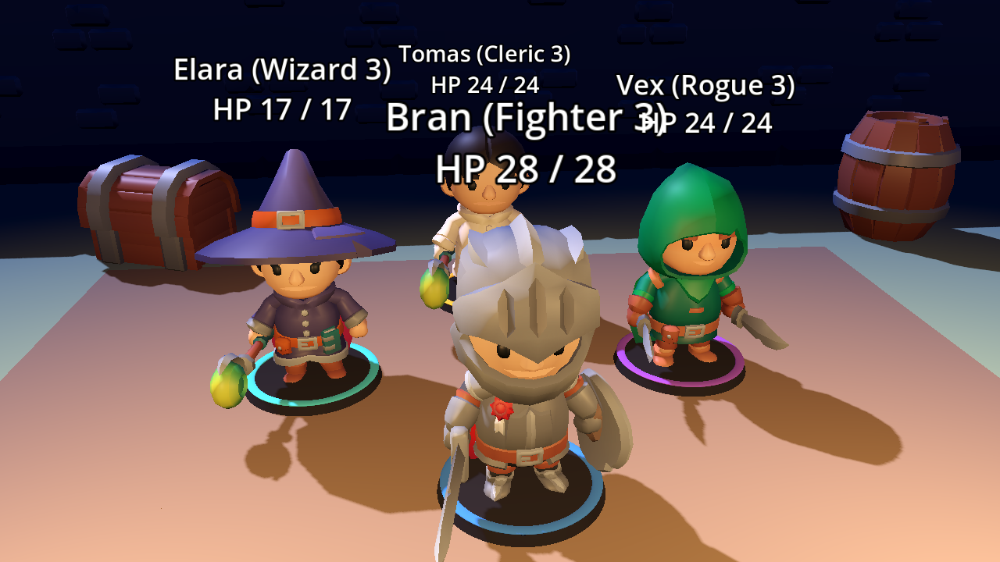
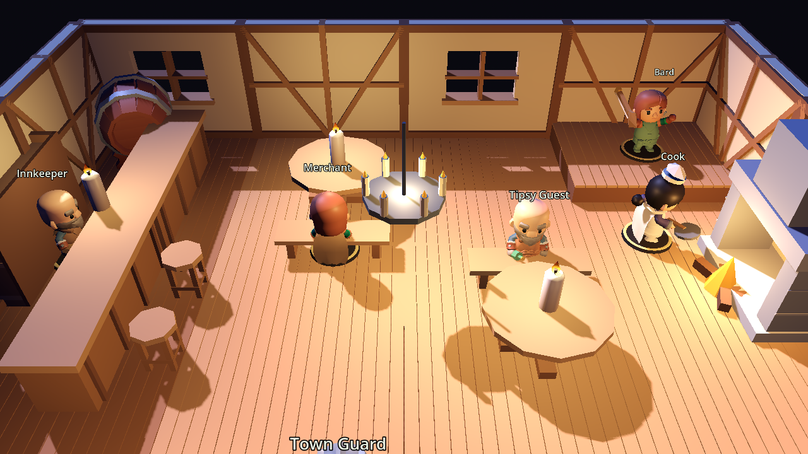
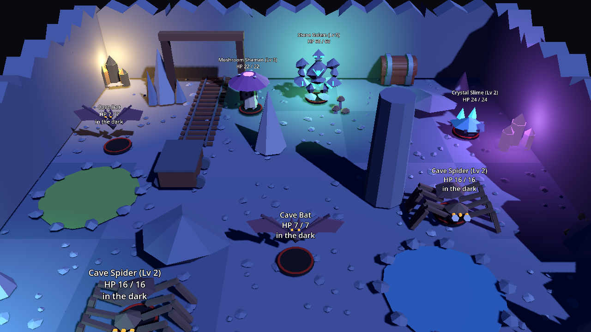
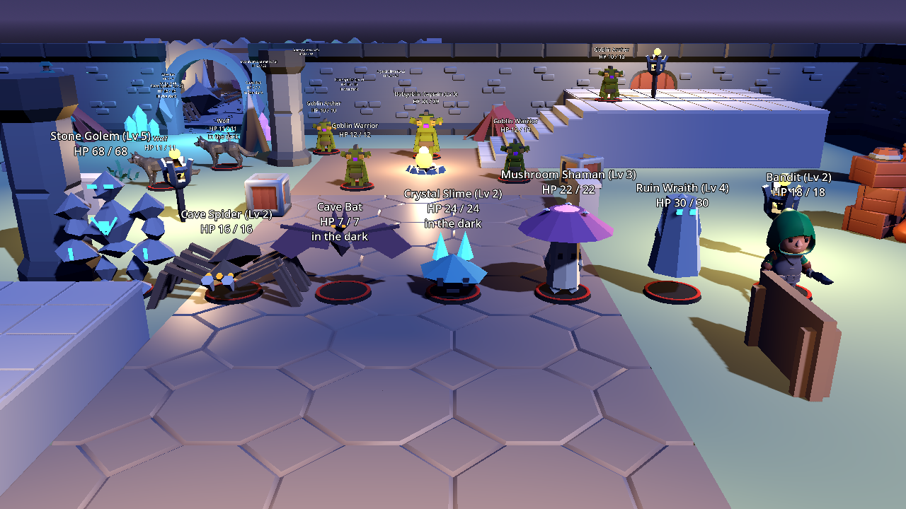
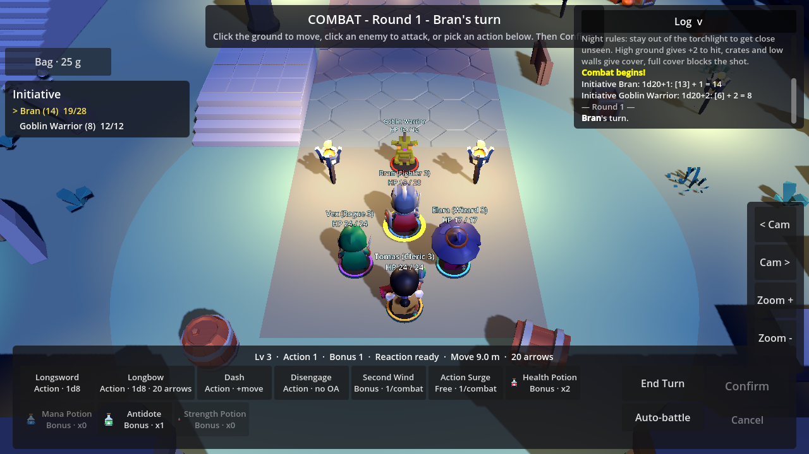
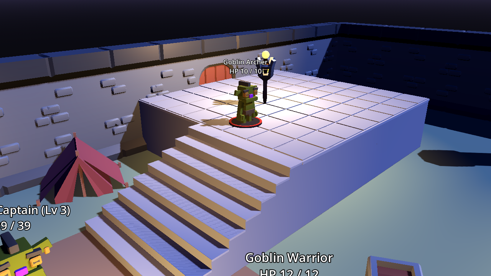
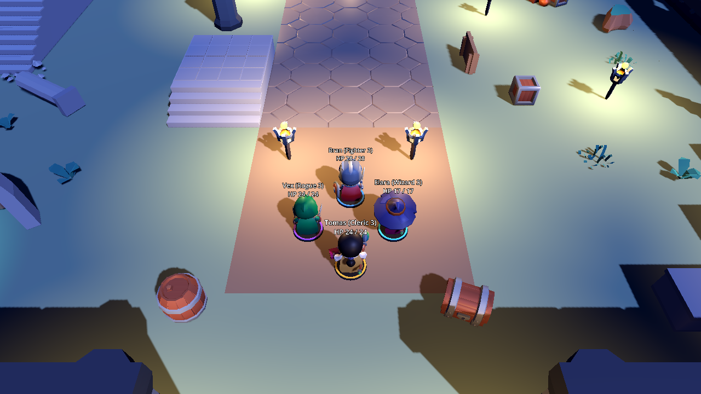

# Dnd – 3D-RPG-Prototyp (Vertical Slice, Test 9: Inventar, Tränke, Beute)

Trying to make a dnd game using my Baldur's Gate 3 and D&D 5.5e experience.

Aktueller Stand: ein spielbarer Prototyp in **Godot 4.3+**. Eine Viererparty (Fighter, Rogue,
Wizard, Cleric, Stufe 3) erkundet eine kleine Testszene, wird von Goblins, Wölfen und einem
Hobgoblin-Captain entdeckt und kämpft rundenbasiert mit Initiative, Action / Bonus Action /
Reaction / Bewegung, Nah- und Fernkampf, Zaubern mit Spell Slots, Rettungswürfen,
Concentration, Status-Effekten, Opportunity Attacks, Sneak Attack und Multiattack.
Flächenzauber werden auf einen Punkt gezielt, jede Aktion wird per **Lock & Roll** bestätigt,
besiegte Gegner bringen XP und Level-Ups (Stufe 3 bis 8), und nach einem Sieg kann die Party
rasten und die nächste Welle rufen.

Die Szene spielt **nachts**: Fackeln und ein Lagerfeuer sind die einzigen Lichtquellen, und das
Licht ist eine Regel. Wer im Dunkeln steht, wird erst aus der Nähe bemerkt und schießt unbemerkt
mit Vorteil; wer ins Dunkle schießt, hat Nachteil. Die Arena hat **Höhenebenen** (eine
Schützen-Anhöhe mit Treppe, ein dunkler Aussichtsfelsen, ein Hügel am Lager): von oben trifft man
mit +2, nach oben mit -2. Kisten, Mauern und Säulen geben **Deckung** per Sichtlinien-Raycast:
halbe (+2 AC) oder Dreiviertel-Deckung (+5 AC), hinter einer Säule ist das Ziel nicht anvisierbar.

Die Welt hängt zusammen: Im Süden führt ein Tor aus der Arena über einen Hof in die **Taverne**
(Wirt hinter der Theke, Köchin am Kamin, Barde auf der Bühne, Händler und ein beschwipster Gast an
den Tischen, Stadtwache an der Tür). Die Leute sind neutral: niemand greift sie an, sie greifen
niemanden an, und sie stehen in keinem Kampf. Im Norden führt der Tunnel in der Arenawand in eine
dunkle **Höhle** mit eigenem Encounter: zwei Spinnen, zwei Fledermäuse, ein Kristallschleim, ein
Pilzschamane und am Ende der Steingolem, der die Schatztruhe bewacht. Die Höhle und die Arena-Wellen
mischen sich nie: es kämpft nur die Gruppe, zu der der Entdecker gehört. Die Höhlenbewohner kommen
nicht wieder, die Arena-Wellen laufen unabhängig davon weiter.









Die Szene und die Figuren kommen aus den vier Asset-Paketen unter `assets/` (alles CC0):
KayKit Dungeon Remastered (Mauern, Säulen, Kisten, Fackeln, Bodenplatten), Kenney Nature Kit
(Bäume, Felsen, Zelte, Lagerfeuer), eigene Raster-Plattformen und Treppen für die Höhenebenen,
Ruinen- und Höhlenbauteile (Altar, Sarkophag, Säulenreste, Torbogen, Statue, Feuerbecken,
Runenstein, Höhleneingang mit Kristallen und Leuchtpilzen), KayKit Adventurers für die Helden
(Ritter, Schurkin mit Kapuze, Magierin, Kleriker-Variante), Quaternius für Goblins und Wolf und
die eigenen Kreaturen des Figurenpakets für spätere Wellen (Höhlenspinne, Fledermaus,
Kristallschleim, Pilzschamane, Ruinengeist, Wegelagerer, Steingolem). Die Helden haben 76
Animationsclips, der Goblin 7, der Wolf 24, die Kreaturen 9 (inklusive Slam und Spawn); das Spiel
spielt Idle, Laufen, Angriff, Schlag, Schuss, Zauber, Treffer und Tod über einen kleinen Adapter
(`CharacterAnimator`). Jede Figur steht wie eine Miniatur auf einem Sockel mit
Fraktionsring. Alles Visuelle sitzt in `ActorVisual`, das Gelände in `TerrainBuilder`; die
Kampflogik kennt davon nichts (siehe `docs/ARCHITECTURE.md`). Fehlt ein Modell, springen die
Primitiv-Miniaturen aus `MiniatureBuilder` ein, fehlt ein Umgebungsmodell, ein Platzhalterblock.
Die Original-ZIPs der Pakete liegen ebenfalls unter `assets/` (nur die benutzten Modelle sind
entpackt; weitere lassen sich daraus nachziehen, Lizenzen unter `assets/licenses/`).

## Starten

1. [Godot 4.3 oder neuer](https://godotengine.org/download) herunterladen (Standard-Version, kein .NET nötig).
2. Godot starten → **Importieren** → die Datei `project.godot` in diesem Ordner auswählen.
3. Im Editor **F5** drücken (oder oben rechts „Play“).

Läuft auch direkt im **Godot-Editor auf Android**: Projekt dort importieren und starten.
Die komplette Steuerung geht per Touch, Maus und Tastatur sind optional.

## Steuerung

| Modus | Touch / Maus | Tastatur (optional) | Wirkung |
|---|---|---|---|
| Erkundung | Joystick unten links | `W A S D` | Anführer (Bran) laufen lassen, die Party folgt |
| Erkundung | Tippen auf Boden | Linksklick | Laufen per Tipp entlang des Navmeshs |
| beide | Buttons „< Cam“ / „Cam >“ | `Q` / `E` | Kamera um 45° drehen |
| beide | Buttons „Zoom +“ / „Zoom -“ | Mausrad | Zoom |
| Kampf | Tippen auf Boden | | Weg wird vorgeschaut (rot = provoziert Opportunity Attack), dann **Confirm** oder erneut tippen |
| Kampf | Tippen auf Gegner | | Angriff mit der besten Waffe wird gesperrt, dann **Confirm** oder erneut tippen |
| Kampf | Button unten, dann Ziel tippen | | Waffe / Zauber / Fähigkeit auf Gegner, Verbündeten oder sich selbst sperren, dann **Confirm** |
| Kampf | Flächenzauber, dann Boden tippen | | Kreis zeigt die Fläche und alle betroffenen Figuren (rot, wenn Freunde drin stehen), dann **Confirm** |
| Kampf | Button „Cancel“ | Rechtsklick / `Esc` | Sperre und Auswahl aufheben |
| Kampf | Button „Confirm“ | `Enter` | Gesperrte Aktion ausführen |
| Kampf | Button „End Turn“ | `Leertaste` | Zug beenden |
| Kampf | Button „Auto-battle“ | | Die Party spielt sich selbst (dieselbe KI wie im Test) |
| Game Over | Button „Restart“ | `R` | Neustart |
| Erkundung | Button „Short rest & wave N“ | | Nach einem Sieg: Party geht ins Lager zurück, kurze Rast (etwas Heilung, Second Wind / Action Surge, halbe Pfeile), Gegner kommen skaliert zurück |
| Erkundung | Button „Long rest“ | | Nur nach jeder dritten Welle: alles zurück, auch Zauber-Slots |
| beide | Button „Log“ | | Würfel-Log ein-/ausklappen |

Im Kampf steuerst du immer die Figur, die gerade am Zug ist. Die Aktionsleiste zeigt alle
Aktionen der Figur mit Kosten (Action / Bonus / Frei) und Zauberstufe samt Slots.

**Lock & Roll**: Nichts passiert durch einen einzelnen Tipp. Erst wird das Ziel (Figur, Punkt
oder Weg) gesperrt und vorgeschaut, die Hinweiszeile oben sagt, was passieren würde (etwa
„Fireball hits Goblin, Wolf, Elara (ally!)“ oder „Move 6 m - provokes an opportunity attack
from Wolf!“). Dann Confirm, oder dasselbe Ziel noch einmal antippen.

## Level-Ups

Besiegte Gegner geben XP (Goblin/Wolf 50, Hobgoblin-Captain 700), aufgeteilt auf die Party.
Stufe 4 ab 200 XP, Stufe 5 ab 450, dann 800, 1250, 1800. Nach dem Kampf zeigt ein Fenster,
was jeder bekommen hat. Änderungen gelten sofort, ohne die Datendateien anzufassen.

| Stufe | Alle | Fighter | Rogue | Wizard | Cleric |
|---|---|---|---|---|---|
| 4 | HP (halber Trefferwürfel + 1 + CON), +1 auf den Hauptattribut-Modifikator | Second Wind 1d10+4 | | Slots 4/3, Shatter, Misty Step | Slots 4/3 |
| 5 | HP, Übungsbonus +3 (Angriffe, Saves, DC) | Extra Attack | Sneak Attack 3d6 | Slots 4/3/2, Fireball, Cantrips 2 Würfel | Slots 4/3/2, Mass Healing Word, Cantrips 2 Würfel |

Neue Zauber: **Shatter** (L2, Punkt, 3 m Radius, 3d8 Donner, CON-Save halbiert, trifft auch
Freunde), **Misty Step** (L2, Bonus Action, Teleport 9 m, keine Opportunity Attack),
**Fireball** (L3, Punkt, 6 m Radius, 8d6 Feuer, DEX-Save halbiert, trifft auch Freunde),
**Mass Healing Word** (L3, Bonus Action, bis zu sechs Verbündete 1d4 + WIS).

## Die Party (Stufe 3)

| | HP | AC | Waffen | Besonderes | Zauber (Slots L1/L2: 4/2) |
|---|---|---|---|---|---|
| **Bran** (Fighter) | 28 | 16 | Longsword 1d8+3, Longbow 1d8+1 | Second Wind (Bonus, 1d10+3), Action Surge (2. Action) | – |
| **Vex** (Rogue) | 24 | 14 | Shortsword 1d6+3, Shortbow 1d6+3, Dagger (Off-hand, Bonus) | Sneak Attack 2d6, Cunning Action (Dash/Disengage als Bonus) | – |
| **Elara** (Wizard) | 17 | 12 | Dagger | Spell-DC 13, Zauberangriff +5 | Fire Bolt, Ray of Frost, Magic Missile, Burning Hands, Scorching Ray |
| **Tomas** (Cleric) | 24 | 16 | Mace 1d6+2 | Spell-DC 13, Zauberangriff +5 | Sacred Flame, Guiding Bolt, Cure Wounds, Healing Word (Bonus), Bless (Conc.), Hold Person (Conc.) |

Gegner: 1 Goblin Warrior, 2 Goblin Archer, 2 Wölfe (Biss mit STR-Rettungswurf gegen
Umwerfen, Pack Tactics), 1 Hobgoblin Captain (AC 17, 39 HP, zwei Angriffe pro Action).

## Regeln (bewusst reduziert, 5e-inspiriert)

* Initiative 1d20 + DEX, jeder einzeln. Pro Zug: 1 Action, 1 Bonus Action, 1 Reaction, Bewegung in Metern (frei, kein Raster).
* Angriff 1d20 + Attribut + Übung gegen AC; natürliche 20 = Crit (doppelte Würfel), natürliche 1 = Fehlschlag.
* **Vorteil / Nachteil** (2d20, höherer bzw. niedrigerer Wurf; beides hebt sich auf) durch Zustände, Guiding Bolt, Pack Tactics, Fernkampf mit angrenzendem Gegner.
* **Rettungswürfe** 1d20 + Attribut (+ Übung) gegen DC. Zauber-DC = 8 + Übung + Attribut.
* **Opportunity Attacks**: Wer die Nahkampfreichweite (1,5 m) eines Gegners verlässt, kassiert dessen Reaction-Angriff. Disengage verhindert das.
* **Ressourcen sind endlich**: Zauber-Slots, Second Wind und Action Surge laden nicht mehr pro Kampf auf. Kurze Rast zwischen den Wellen: ein Trefferwürfel Heilung pro zwei Stufen, Kämpfer-Features und die Hälfte der Pfeile. Lange Rast (nur nach jeder dritten Welle): alles. Cantrips sind gratis und würfeln ab Stufe 5 doppelt.
* **Pfeile**: Langbogen und Kurzbogen haben 20 Pfeile, Goblin-Bogenschützen 8 (danach greifen sie mit dem Dolch an). Die Aktionsleiste zeigt den Vorrat.
* **Wellen skalieren**: Beim Respawn werden alle Gegner auf das durchschnittliche Party-Level gehoben (+20 % HP pro Stufe, alle zwei Stufen +1 auf Treffer, Schaden und AC, mehr XP), und ab Welle 3 kommt pro Welle ein zusätzlicher Goblin-Krieger dazu (bis vier).
* **Inventar und Tränke**: Die Party hat einen gemeinsamen Beutel (Knopf oben links, zeigt das Gold). Vier Tränke: Heiltrank (2d4+2, belebt Gefallene), Manatrank (gibt den höchsten verbrauchten Zauberslot zurück), Gegengift (heilt Poisoned), Stärketrank (+2 Waffenschaden für 5 Runden). Dazu Pfeilbündel (+10 Pfeile). Im Kampf sind Tränke eine **Bonus Action** auf der Aktionsleiste, auch für einen Verbündeten in 1,5 m, auch für einen Gefallenen. Außerhalb des Kampfes geht ein Trank aus dem Beutel an das Mitglied, das ihn am nötigsten hat. Die KI-Party trinkt unter 40 % HP und bei Gift.
* **Beute**: Besiegte Gegner hinterlassen Gold (XP-Wert geteilt durch 10) und mit 15 % Wahrscheinlichkeit einen Trank. Kisten in der Welt (Truhe am Lager, Schatztruhe hinter dem Golem) werden angetippt, der Anführer läuft hin und plündert sie einmal. Start: 25 Gold, zwei Heiltränke, ein Gegengift. Händler, Ausrüstung und Speichern folgen.
* **Höhlen-Encounter**: eigener Kampf mit sieben Bewohnern, ausgelöst durch deren Wahrnehmung (die Höhle ist dunkel bis auf Kristalle und Pilze, also kommt man bis auf 3,4 m heran). Nur Gegner derselben Gruppe im Umkreis von 16 m des Entdeckers schließen sich an. XP wie gewohnt; die Rast nach einer Welle hängt nur von den Arena-Gegnern ab.
* **Taverne**: sechs neutrale NPCs mit eigenen Posen (Sitzen, Jubeln, Hantieren). Neutral heißt: `is_hostile_to` ist in beide Richtungen falsch, keine Aktion kann sie anvisieren, Flächenzauber können sie aber treffen, wenn man sie in den Radius nimmt.
* **Neue Kreaturen aus dem Höhleneingang** (bleiben ab ihrer Welle dabei): Welle 2 Fledermaus; Welle 3 Höhlenspinne (giftiger Biss: CON-Save DC 11, sonst **Poisoned** = Nachteil auf Angriffe, CON-Wiederholungssave) und Kristallschleim (24 HP, langsam, Säure); Welle 4 zweite Spinne, Pilzschamane (Sporenspucke auf 9 m mit Gift) und ein Wegelagerer (Sneak Attack 1d6); Welle 5 Ruinengeist (Lebensentzug 2d6) und zweiter Wegelagerer; Welle 6 der **Steingolem** (68 HP, AC 17, zwei Schläge 2d8+5, langsam). Alles in `World.WAVE_ARRIVALS` als Daten, jede Kreatur ist eine `.tres` mit Modell.
* **Wegfindung** weicht anderen Figuren aus, stellt ein besetztes Ziel daneben und gleitet bei Berührung an Körpern entlang statt stehen zu bleiben. Figuren folgen dem Gelände (Schwerkraft, Treppen), Bewegung wird auf der Bodenebene gemessen.
* **Höhe**: Steht der Angreifer mindestens 1 m höher als das Ziel, bekommt er +2 auf den Angriffswurf; steht er mindestens 1 m tiefer, -2. Gilt für Waffen und Zauberangriffe. Die Schützen-Anhöhe und der Aussichtsfelsen sind 2 m hoch, der Hügel am Lager 1 m; alle haben Treppen (unter der Treppe liegt ein glatter Collider, damit die Figuren hinaufgleiten). Direkt am Fuß einer Klippe verdeckt die Kante den Unterkörper, das zählt als Deckung.
* **Sichtlinie & Deckung**: Von den Augen des Angreifers gehen fünf Strahlen zu Augen, Brust, Knien und beiden Schultern des Ziels (nur Levelgeometrie blockiert, keine Kreaturen). 1–2 blockiert = halbe Deckung (+2 AC, +2 auf DEX-Saves), 3–4 = Dreiviertel-Deckung (+5), alle 5 = volle Deckung: kein Ziel sichtbar, Angriff und Zauber werden verweigert (der Log erklärt warum). Nahkampf ignoriert Deckung. Flächenzauber brauchen einen sichtbaren Zielpunkt, Deckung gegen die Explosion wird vom Punkt aus gemessen. Kisten sind 1 m hoch, Mauern 0,9 m, Säulen 4 m.
* **Licht & Schatten** (Stealth): Eine Figur ist beleuchtet, wenn eine Fackel (6 m) oder das Lagerfeuer (7 m) sie mit freier Linie erreicht; gerenderte Schatten spielen keine Rolle. Im Dunkeln bemerken Gegner sie erst auf 40 % der Wahrnehmungsreichweite (3,4 m statt 8,5 m) und nur mit Sichtlinie. Fernangriffe und Zauberangriffe aus dem Dunkeln haben **Vorteil**, bis der Angreifer zuschlägt (dann ist er bis zu seinem nächsten Zug „entdeckt“); Fernangriffe auf ein Ziel im Dunkeln aus mehr als 3 m haben **Nachteil**. Das Label über der Figur zeigt „in the dark“, die Lock-&-Roll-Zeile fasst Deckung, Höhe und Licht vor dem Bestätigen zusammen.
* **Concentration**: nur ein Concentration-Zauber gleichzeitig; Schaden erzwingt einen CON-Rettungswurf (DC 10 oder halber Schaden), Fehlschlag oder Down beendet den Zauber und alle verknüpften Effekte.
* **Status-Effekte**: Blessed (+1d4 Angriff/Saves), Guided (Vorteil auf den nächsten Angriff), Slowed (-3 m), Paralyzed (handlungsunfähig, Angriffe mit Vorteil, Nahkampftreffer sind Crits, Wiederholungs-Save am Zugende), Prone (Nachteil auf eigene Angriffe, Nahkampf gegen sich mit Vorteil, Aufstehen kostet halbe Bewegung), Disengaging.
* 0 HP = „Down“. Heilung (Healing Word, Cure Wounds) holt Gefallene zurück. Nach einem Sieg stehen alle mit 1 HP auf. Ist die ganze Party down → Game Over.
* Noch nicht enthalten: Todesrettungswürfe, Resistenzen, Reaktionszauber (Shield), Ausrüstung mit Slots und Händler (Icons, Rüstungs- und Waffenmodelle liegen schon unter `assets/shop/`), Projektile, Speichern, freie Attributswahl beim Level-Up (der Hauptwert steigt automatisch), Verstecken als Aktion, Kreaturen als Deckung, Gespräche mit den Tavernenleuten.

## Tests (ohne Editor)

```bash
# Regelschicht: Würfel, Vorteil, Angriffe, Sneak Attack, Saves, Status, Concentration, Slots, Multiattack
godot --headless --path . res://tests/unit_tests.tscn

# Szenarien in der echten Szene: Opportunity Attack, Disengage, Hold Person (Lähmung, Zug überspringen,
# Wiederholungs-Save, Auto-Crit, Concentration-Verlust), Healing Word belebt wieder, Fireball,
# Misty Step, Umgehen von Körpern, Treppen hinauf, Höhenbonus, Deckung hinter Kiste/Säule,
# sichtbare Zielpunkte, Licht und Wahrnehmung im Dunkeln
godot --headless --path . -- --scenario

# Kompletter Loop: Joystick, Tippen, Party folgt, Kampf (erster Zug per Lock & Confirm, Rest per KI),
# Sieg, Level-Up, Rest & zweite Welle, Stufe 5
godot --headless --path . -- --autoplay --seed=4

# Alles nacheinander
./tests/run_all.sh

# Screenshots der Figuren, der Party, der Anhöhe, des Lagers, der Taverne und der Höhle rendern (braucht ein Display oder xvfb-run)
xvfb-run godot --rendering-driver opengl3 --path . -- --screenshot --shot-dir=/tmp/shots
# HUD mit offenem Beutel und Aktionsleiste im Kampf
xvfb-run godot --rendering-driver opengl3 --path . -- --hudshot
```

Der Seed macht die Würfel reproduzierbar. Über dreizehn Seeds gewinnt die KI-Party sieben erste Wellen (die Nachtregeln helfen ihr: sie schleicht im Dunkeln an das beleuchtete Lager heran und eröffnet mit Vorteil) und drei von sieben zweiten Wellen gegen die hochskalierten Gegner. Welche Seeds verloren gehen, wechselt mit jeder Geometrieänderung; die Kämpfe sind knapp.

## Projektstruktur

```
project.godot
scenes/           main.tscn (Testarena, Party, Gegner), actors/, ui/
scripts/core/     GameState, EventBus, InputSetup, Dice, DiceResult, ScreenRaycast
scripts/data/     ActorData, ActorStats, WeaponData, SpellData, StatusEffectData (Resources)
scripts/actors/   Actor, ActorVisual, CharacterAnimator, MiniatureBuilder, PlayerController, PartyFollower, EnemyPerception
scripts/items/    Inventory (Beutel der Party)
scripts/combat/   CombatManager, InitiativeTracker, TurnState, AttackResolver, AttackProfile,
                  SavingThrow, SpellResolver, StatusEffect, Progression, Targeting, CombatMovement,
                  Visibility (Sichtlinie, Deckung, Höhe), Lighting (Licht/Schatten), CombatSituation,
                  PlayerCombatInput, actions/ (Attack, Offhand, Spell, Dash, Disengage, Second Wind,
                  Action Surge, UseItem), ai/ (CombatAI, PartyAI), EnemyAI
scripts/world/    World (Wellentabelle, Arena-/Höhlen-Gruppen, NPCs, Beute), TerrainBuilder (Arena, Taverne, Höhle, Plateaus, Treppen, Mauern, Ruinen, Lichter), Terrain (Bodenhöhe), LootChest,
                  LightSource, CameraRig, TargetingPreview
scripts/ui/       CombatHud, HudJoystick, ActorLabel, FloatingText
data/             .tres für Helden, Gegner (inkl. Modell, Maßstab, Ausrüstung), Waffen, Zauber, Status-Effekte und Items
assets/           Benutzte GLB-Modelle (characters/, kaykit/, kenney/, custom_grid/, environment_expansion/), shop/ (Icons, Tränke, Projektile, Rüstungen, Sounds, Effekte), Kataloge, Lizenzen, Original-ZIPs
tests/            Unit-Tests, Szenario-Test, Autoplay-Integrationstest, run_all.sh
docs/             Architekturbeschreibung, Screenshots
```
