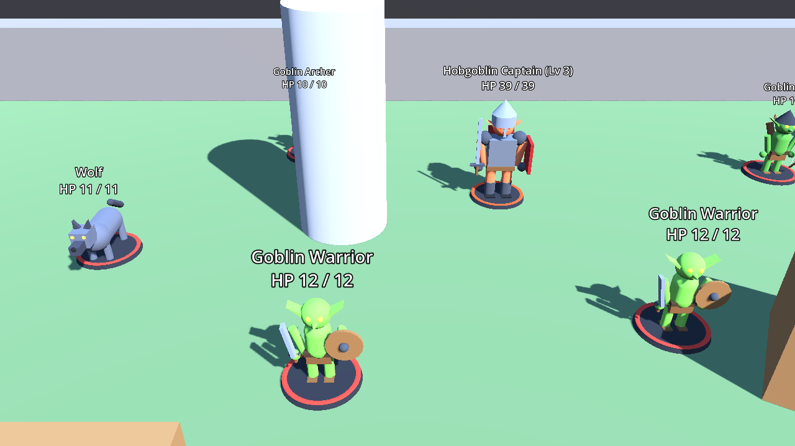

# Dnd – 3D-RPG-Prototyp (Vertical Slice, Test 4: Wellen, Ressourcen, Wegfindung)

Trying to make a dnd game using my Baldur's Gate 3 and D&D 5.5e experience.

Aktueller Stand: ein spielbarer Prototyp in **Godot 4.3+**. Eine Viererparty (Fighter, Rogue,
Wizard, Cleric, Stufe 3) erkundet eine kleine Testszene, wird von Goblins, Wölfen und einem
Hobgoblin-Captain entdeckt und kämpft rundenbasiert mit Initiative, Action / Bonus Action /
Reaction / Bewegung, Nah- und Fernkampf, Zaubern mit Spell Slots, Rettungswürfen,
Concentration, Status-Effekten, Opportunity Attacks, Sneak Attack und Multiattack.
Flächenzauber werden auf einen Punkt gezielt, jede Aktion wird per **Lock & Roll** bestätigt,
besiegte Gegner bringen XP und Level-Ups (Stufe 3 bis 8), und nach einem Sieg kann die Party
rasten und die nächste Welle rufen.

Die Gegner sind Tabletop-Miniaturen aus Primitiven auf runden Sockeln (Goblin mit Säbel und
Schild, Bogenschütze, Wolf, Hobgoblin-Captain), ohne Animation: die Figuren gleiten wie
Spielfiguren über den Boden.


 Die Helden sind noch Kapseln auf Sockeln. Alles Visuelle sitzt in
`ActorVisual` / `MiniatureBuilder`, die Kampflogik kennt davon nichts (siehe `docs/ARCHITECTURE.md`).

## Starten

1. [Godot 4.3 oder neuer](https://godotengine.org/download) herunterladen (Standard-Version, kein .NET nötig).
2. Godot starten → **Importieren** → die Datei `project.godot` in diesem Ordner auswählen.
3. Im Editor **F5** drücken (oder oben rechts „Play“).

Läuft auch direkt im **Godot-Editor auf Android**: Projekt dort importieren und starten.
Die komplette Steuerung geht per Touch, Maus und Tastatur sind optional.

## Steuerung

| Modus | Touch / Maus | Tastatur (optional) | Wirkung |
|---|---|---|---|
| Erkundung | Joystick unten links | `W A S D` | Anführer (Bran) laufen lassen, die Party folgt |
| Erkundung | Tippen auf Boden | Linksklick | Laufen per Tipp entlang des Navmeshs |
| beide | Buttons „< Cam“ / „Cam >“ | `Q` / `E` | Kamera um 45° drehen |
| beide | Buttons „Zoom +“ / „Zoom -“ | Mausrad | Zoom |
| Kampf | Tippen auf Boden | | Weg wird vorgeschaut (rot = provoziert Opportunity Attack), dann **Confirm** oder erneut tippen |
| Kampf | Tippen auf Gegner | | Angriff mit der besten Waffe wird gesperrt, dann **Confirm** oder erneut tippen |
| Kampf | Button unten, dann Ziel tippen | | Waffe / Zauber / Fähigkeit auf Gegner, Verbündeten oder sich selbst sperren, dann **Confirm** |
| Kampf | Flächenzauber, dann Boden tippen | | Kreis zeigt die Fläche und alle betroffenen Figuren (rot, wenn Freunde drin stehen), dann **Confirm** |
| Kampf | Button „Cancel“ | Rechtsklick / `Esc` | Sperre und Auswahl aufheben |
| Kampf | Button „Confirm“ | `Enter` | Gesperrte Aktion ausführen |
| Kampf | Button „End Turn“ | `Leertaste` | Zug beenden |
| Kampf | Button „Auto-battle“ | | Die Party spielt sich selbst (dieselbe KI wie im Test) |
| Game Over | Button „Restart“ | `R` | Neustart |
| Erkundung | Button „Short rest & wave N“ | | Nach einem Sieg: Party geht ins Lager zurück, kurze Rast (etwas Heilung, Second Wind / Action Surge, halbe Pfeile), Gegner kommen skaliert zurück |
| Erkundung | Button „Long rest“ | | Nur nach jeder dritten Welle: alles zurück, auch Zauber-Slots |
| beide | Button „Log“ | | Würfel-Log ein-/ausklappen |

Im Kampf steuerst du immer die Figur, die gerade am Zug ist. Die Aktionsleiste zeigt alle
Aktionen der Figur mit Kosten (Action / Bonus / Frei) und Zauberstufe samt Slots.

**Lock & Roll**: Nichts passiert durch einen einzelnen Tipp. Erst wird das Ziel (Figur, Punkt
oder Weg) gesperrt und vorgeschaut, die Hinweiszeile oben sagt, was passieren würde (etwa
„Fireball hits Goblin, Wolf, Elara (ally!)“ oder „Move 6 m - provokes an opportunity attack
from Wolf!“). Dann Confirm, oder dasselbe Ziel noch einmal antippen.

## Level-Ups

Besiegte Gegner geben XP (Goblin/Wolf 50, Hobgoblin-Captain 700), aufgeteilt auf die Party.
Stufe 4 ab 200 XP, Stufe 5 ab 450, dann 800, 1250, 1800. Nach dem Kampf zeigt ein Fenster,
was jeder bekommen hat. Änderungen gelten sofort, ohne die Datendateien anzufassen.

| Stufe | Alle | Fighter | Rogue | Wizard | Cleric |
|---|---|---|---|---|---|
| 4 | HP (halber Trefferwürfel + 1 + CON), +1 auf den Hauptattribut-Modifikator | Second Wind 1d10+4 | | Slots 4/3, Shatter, Misty Step | Slots 4/3 |
| 5 | HP, Übungsbonus +3 (Angriffe, Saves, DC) | Extra Attack | Sneak Attack 3d6 | Slots 4/3/2, Fireball, Cantrips 2 Würfel | Slots 4/3/2, Mass Healing Word, Cantrips 2 Würfel |

Neue Zauber: **Shatter** (L2, Punkt, 3 m Radius, 3d8 Donner, CON-Save halbiert, trifft auch
Freunde), **Misty Step** (L2, Bonus Action, Teleport 9 m, keine Opportunity Attack),
**Fireball** (L3, Punkt, 6 m Radius, 8d6 Feuer, DEX-Save halbiert, trifft auch Freunde),
**Mass Healing Word** (L3, Bonus Action, bis zu sechs Verbündete 1d4 + WIS).

## Die Party (Stufe 3)

| | HP | AC | Waffen | Besonderes | Zauber (Slots L1/L2: 4/2) |
|---|---|---|---|---|---|
| **Bran** (Fighter) | 28 | 16 | Longsword 1d8+3, Longbow 1d8+1 | Second Wind (Bonus, 1d10+3), Action Surge (2. Action) | – |
| **Vex** (Rogue) | 24 | 14 | Shortsword 1d6+3, Shortbow 1d6+3, Dagger (Off-hand, Bonus) | Sneak Attack 2d6, Cunning Action (Dash/Disengage als Bonus) | – |
| **Elara** (Wizard) | 17 | 12 | Dagger | Spell-DC 13, Zauberangriff +5 | Fire Bolt, Ray of Frost, Magic Missile, Burning Hands, Scorching Ray |
| **Tomas** (Cleric) | 24 | 16 | Mace 1d6+2 | Spell-DC 13, Zauberangriff +5 | Sacred Flame, Guiding Bolt, Cure Wounds, Healing Word (Bonus), Bless (Conc.), Hold Person (Conc.) |

Gegner: 1 Goblin Warrior, 2 Goblin Archer, 2 Wölfe (Biss mit STR-Rettungswurf gegen
Umwerfen, Pack Tactics), 1 Hobgoblin Captain (AC 17, 39 HP, zwei Angriffe pro Action).

## Regeln (bewusst reduziert, 5e-inspiriert)

* Initiative 1d20 + DEX, jeder einzeln. Pro Zug: 1 Action, 1 Bonus Action, 1 Reaction, Bewegung in Metern (frei, kein Raster).
* Angriff 1d20 + Attribut + Übung gegen AC; natürliche 20 = Crit (doppelte Würfel), natürliche 1 = Fehlschlag.
* **Vorteil / Nachteil** (2d20, höherer bzw. niedrigerer Wurf; beides hebt sich auf) durch Zustände, Guiding Bolt, Pack Tactics, Fernkampf mit angrenzendem Gegner.
* **Rettungswürfe** 1d20 + Attribut (+ Übung) gegen DC. Zauber-DC = 8 + Übung + Attribut.
* **Opportunity Attacks**: Wer die Nahkampfreichweite (1,5 m) eines Gegners verlässt, kassiert dessen Reaction-Angriff. Disengage verhindert das.
* **Ressourcen sind endlich**: Zauber-Slots, Second Wind und Action Surge laden nicht mehr pro Kampf auf. Kurze Rast zwischen den Wellen: ein Trefferwürfel Heilung pro zwei Stufen, Kämpfer-Features und die Hälfte der Pfeile. Lange Rast (nur nach jeder dritten Welle): alles. Cantrips sind gratis und würfeln ab Stufe 5 doppelt.
* **Pfeile**: Langbogen und Kurzbogen haben 20 Pfeile, Goblin-Bogenschützen 8 (danach greifen sie mit dem Dolch an). Die Aktionsleiste zeigt den Vorrat.
* **Wellen skalieren**: Beim Respawn werden alle Gegner auf das durchschnittliche Party-Level gehoben (+20 % HP pro Stufe, alle zwei Stufen +1 auf Treffer, Schaden und AC, mehr XP), und ab Welle 3 kommt pro Welle ein zusätzlicher Goblin-Krieger dazu (bis vier).
* **Wegfindung** weicht anderen Figuren aus, stellt ein besetztes Ziel daneben und gleitet bei Berührung an Körpern entlang statt stehen zu bleiben.
* **Concentration**: nur ein Concentration-Zauber gleichzeitig; Schaden erzwingt einen CON-Rettungswurf (DC 10 oder halber Schaden), Fehlschlag oder Down beendet den Zauber und alle verknüpften Effekte.
* **Status-Effekte**: Blessed (+1d4 Angriff/Saves), Guided (Vorteil auf den nächsten Angriff), Slowed (-3 m), Paralyzed (handlungsunfähig, Angriffe mit Vorteil, Nahkampftreffer sind Crits, Wiederholungs-Save am Zugende), Prone (Nachteil auf eigene Angriffe, Nahkampf gegen sich mit Vorteil, Aufstehen kostet halbe Bewegung), Disengaging.
* 0 HP = „Down“. Heilung (Healing Word, Cure Wounds) holt Gefallene zurück. Nach einem Sieg stehen alle mit 1 HP auf. Ist die ganze Party down → Game Over.
* Noch nicht enthalten: Todesrettungswürfe, Deckung, Resistenzen, Reaktionszauber (Shield), Inventar, freie Attributswahl beim Level-Up (der Hauptwert steigt automatisch).

## Tests (ohne Editor)

```bash
# Regelschicht: Würfel, Vorteil, Angriffe, Sneak Attack, Saves, Status, Concentration, Slots, Multiattack
godot --headless --path . res://tests/unit_tests.tscn

# Szenarien in der echten Szene: Opportunity Attack, Disengage, Hold Person (Lähmung, Zug überspringen,
# Wiederholungs-Save, Auto-Crit, Concentration-Verlust), Healing Word belebt wieder
godot --headless --path . -- --scenario

# Kompletter Loop: Joystick, Tippen, Party folgt, Kampf (erster Zug per Lock & Confirm, Rest per KI),
# Sieg, Level-Up, Rest & zweite Welle, Stufe 5
godot --headless --path . -- --autoplay --seed=4

# Alles nacheinander
./tests/run_all.sh

# Screenshots der Figuren rendern (braucht ein Display oder xvfb-run)
xvfb-run godot --rendering-driver opengl3 --path . -- --screenshot --shot-dir=/tmp/shots
```

Der Seed macht die Würfel reproduzierbar. Über zwölf Seeds gewinnt die KI-Party etwa zwei von drei Kämpfen.

## Projektstruktur

```
project.godot
scenes/           main.tscn (Testarena, Party, Gegner), actors/, ui/
scripts/core/     GameState, EventBus, InputSetup, Dice, DiceResult, ScreenRaycast
scripts/data/     ActorData, ActorStats, WeaponData, SpellData, StatusEffectData (Resources)
scripts/actors/   Actor, ActorVisual, PlayerController, PartyFollower, EnemyPerception
scripts/combat/   CombatManager, InitiativeTracker, TurnState, AttackResolver, AttackProfile,
                  SavingThrow, SpellResolver, StatusEffect, Progression, Targeting, CombatMovement,
                  PlayerCombatInput, actions/ (Attack, Offhand, Spell, Dash, Disengage, Second Wind,
                  Action Surge), ai/ (CombatAI, PartyAI), EnemyAI
scripts/world/    World, CameraRig, TargetingPreview
scripts/ui/       CombatHud, HudJoystick, ActorLabel, FloatingText
data/             .tres für Helden, Gegner, Waffen, Zauber und Status-Effekte
tests/            Unit-Tests, Szenario-Test, Autoplay-Integrationstest, run_all.sh
docs/             Architekturbeschreibung
```
