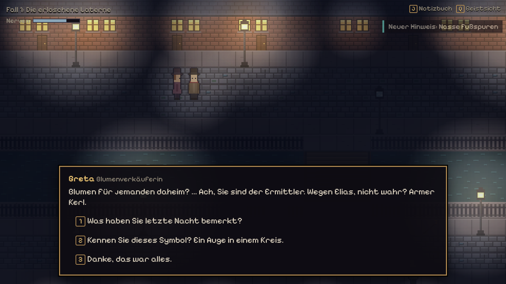

# Nebelakten

Ein 2D-Pixel-Mystery im Browser, top-down und düster: Nebel, Gaslaternen, eine viktorianisch-okkulte Welt.
Man ermittelt, sammelt Quellen, verknüpft Hinweise zu Schlussfolgerungen und steigt nebenbei auf einem von
zehn okkulten Pfaden auf, von Sequenz 9 bis hinauf zu Sequenz 1. Die Welt ist eigenständig (inspiriert von
„Lord of the Mysteries“, aber ohne dessen Namen, Figuren oder Orte).



**Online spielen:** https://wuerfelduell.github.io/Dnd/

Läuft am Rechner mit Tastatur oder Gamepad und am Handy per Touch. Deutsch und Englisch sind im Titel- und
Pausenmenü umschaltbar. Zu zweit spielt man lokal an einem Gerät.

## Die Kapitel

Jedes Kapitel spielt in einer eigenen Stadt. Wer weiterreist, kommt nicht mehr zurück (bis auf die
Heimkehr ab Sequenz 3).

| Kapitel | Ort | Worum es geht |
|---|---|---|
| 1 | **Kettlegate** | Neun Fälle rund um das Polizeirevier: der verschwundene Lampenanzünder, Miriam Veys Chor von St. Ebba, gestohlene Stimmen, der dreizehnte Gast, das Finale „Der Sternsammler“ gegen Professor Starling. Dazu viele Nebenaufträge, Nachtmarkt, Kopfgelder und geheime Zirkeltreffen. |
| 2 | **Wexmoor** | Moorstadt, deutlich härter. Eigene Akten, Gilde, Zelle mit Ausbruch, Nebelherz-Reinigung, Einzelgänger als Bürgen für den Zirkel. |
| 3 | **Dunscar** | Bergbau- und Bahnstadt am Ende der Linie. Rache an Starling, offene Welt ab Ankunft, Zirkel nur mit brutalen Stücken, Kopfgeldjäger, die Nachtzug-Nebengeschichte. |
| 4 | **Calderwick** | „Der Aufstieg“: die Stadt der Gefallenen, auf Sequenz 4 (Halbgott) ausgelegt. Stadtplan, Pfadviertel mit Bossen und Rivalen, Splitscreen im Koop. |
| 5 | **Briarholt** | „Die Kur der Gefallenen“, für Sequenz 3 bis 2. |
| 6 | Calderwick ↔ Briarholt | „Der zweite Aufstieg“ bis zum Thron. |
| 7 | **Varrowmouth** | Die Stadt, die das Meer verschluckt: fünf Akte, Gezeiten (Ebbe/Flut verändern die Karten), vier Enden. |

## Spielprinzip

- **Ermitteln:** Hinweise in der Welt (funkelnde Stellen), in Gesprächen und Akten. Eine Information mit einer
  Quelle ist eine *Vermutung*, ab zwei unabhängigen Quellen *sehr wahrscheinlich*. Nicht alles stimmt, auch die
  Polizei irrt. Im Notizbuch werden zwei Informationen zu einer Schlussfolgerung verknüpft (`V`, ab Wexmoor auch
  Auto-Verknüpfen mit `A`). Für eine gute Auflösung braucht man gesicherte Schlussfolgerungen.
- **Ansehen** bei der Polizei öffnet Akten, Dialogoptionen und Abkürzungen. **Beziehungen** zu jeder Figur
  (feindselig, neutral, freundlich) ändern sich durch Gespräche, Aufträge und Geschenke.
- **Pfade und Sequenzen:** zehn Pfade (Laterne, Faden, Maske, Echo, Kessel, Eisen, Schlüssel, Waage, Moor, Uhr),
  je von Sequenz 9 bis 1. Formel kaufen oder finden, Zutaten sammeln, am Braukessel brauen, trinken und den Trank
  durch pfadgerechtes Handeln **verdauen**. Ab Sequenz 6 wird das Verdauen je Stufe deutlich langsamer.
  Sequenz 4 (Halbgott) und 2 (Engel) sind die großen Sprünge, mit Ritualen und einem Schwellenwächter als Boss.
  Ab Sequenz 4 gibt es die **mythische Gestalt**. Zu viel **Unruhe** führt zum Kontrollverlust und korrumpiert
  die Ausrüstung (nie Game Over).
- **Kampf:** rundenbasiert mit Timing. Im goldenen Bereich zuschlagen, beim gegnerischen Ring ausweichen oder
  parieren, Aufladeschläge, Flächenangriffe, Gruppen von bis zu drei Gegnern. Konzentration bezahlt
  Fertigkeiten, Nerven begrenzen sie. Wer verliert, wacht verletzt wieder auf.
- **Welt:** Tag/Nacht mit Wetter und Nebelnächten, Händler, Pfandleiher, Zirkeltreffen mit Auktionen,
  eigenes Haus und Lager, Tragkraft, Bestiarium als Wegweiser, Erfolge, Zeitungen und Post.
- **Spielstände:** drei Speicherplätze im Browser (localStorage), automatisch gespeichert.

## Steuerung

| Spieler 1 | Wirkung |
|---|---|
| `WASD` (allein auch Pfeiltasten) | laufen |
| `E` | untersuchen, sprechen, weiter |
| `Q` | Geistsicht (Aura um Beyonder, verborgene Spuren; kostet Nerven) |
| `J` / `Tab` | Notizbuch (`V` verknüpfen, `A` Auto-Verknüpfen) |
| `I` | Inventar |
| `P` | Pfad: Sequenz, Verdauung, Unruhe, Fähigkeiten, Formeln |
| `1`–`9` | Welt-Fähigkeiten aus der Schnellleiste; im Dialog Antwort wählen |
| `0` | mythische Gestalt (ab Sequenz 4) |
| `Esc` | Pausenmenü (Spieler 2, Sprache, Steuerung, Spielstände) |
| Kampf: `1`–`4` | Angriff, Fertigkeiten, Gegenstände, Flucht |
| Kampf: `E` | Takt beim eigenen Angriff |
| Kampf: `Leertaste` / `F` | ausweichen / parieren |

| Spieler 2 | Wirkung |
|---|---|
| Pfeiltasten / Gamepad-Stick | laufen |
| `Enter` / Gamepad `A` | untersuchen, sprechen, aufheben |
| `I`, dann `G` / Gamepad `Y` | eigenes Inventar |
| Ziffernblock `1`–`9` | Welt-Fähigkeiten |
| Ziffernblock `0` / Gamepad `B` | Geistsicht |
| Ziffernblock `,` | mythische Gestalt |
| Kampf: `Enter` | Takt |
| Kampf: `←` / `→` (Gamepad `X` / `B`) | ausweichen / parieren |

Am Handy: Tippen zum Hinlaufen und Interagieren, Knöpfe für Menüs und Kampf, Vollbild über das Menü
(am iPhone „Zum Home-Bildschirm“).

### Zu zweit an einem Gerät

Spieler 2 kommt über das Pausenmenü (`Esc`) dazu, mit eigener Figur, eigenem Pfad, Leben, Nerven, Inventar und
Waffe. Geld, Ansehen und Fälle gehören dem Ermittler (Spieler 1). Im Kampf handeln beide nacheinander, und jeder
wehrt die Schläge gegen sich selbst ab. In den Calderwicker Pfadvierteln teilt sich das Bild.

## Lokal starten

1. [Node.js](https://nodejs.org) 20 oder neuer installieren.
2. Im Projektordner einmalig `npm install`.
3. `npm run dev` und http://localhost:5173 öffnen. Änderungen erscheinen sofort.

| Befehl | Wirkung |
|---|---|
| `npm run dev` | Entwicklungsserver (Vite) |
| `npm test` | alle Tests (`node --test tests/*.test.js`): Datenprüfung, Kampf- und Balanceregeln, Fälle über die echten Dialoge durchgespielt, Übersetzungen |
| `npm run build` | fertiges Spiel nach `dist/` |
| `npm run preview` | den Build lokal ansehen |

Für Tests einzelner Kapitel gibt es Startparameter in der Adresse, z. B. `?varrowmouth=1`,
`?varrowmouth=hafen` oder `?aufstieg=calderwick&pfad=eisen&koop=1` (siehe `src/main.js`).

## Deployment

`.github/workflows/deploy.yml` testet und baut jeden Pull Request. Jeder Push auf `main` wird zusätzlich auf
GitHub Pages veröffentlicht (Einstellung: Repository → Settings → Pages → Source „GitHub Actions“).

## Technik und Aufbau

- [Phaser 3](https://phaser.io) (WebGL) und [Vite](https://vitejs.dev). Spielauflösung 480×270, ganzzahlig
  hochskaliert, damit die Pixel scharf bleiben. Licht über eine Dunkelheitsebene, Nebel darunter.
- Die Oberfläche (HUD, Dialoge, Notizbuch, Menüs) ist HTML/CSS über dem Canvas.
- Musik ist kein Audiomaterial, sondern Notendaten (JSON), die zur Laufzeit synthetisiert werden.
- Übersetzung: Inhalte sind deutsch, `src/core/I18n.js` übersetzt den angezeigten Text über die Wörterbücher in
  `src/i18n/en/*.json` (Begriffe: `src/i18n/GLOSSAR.md`). Neue Texte brauchen immer auch einen englischen Eintrag.

```
src/
  main.js            Start, Skalierung, Spielstände, Test-Startparameter
  core/              Spielregeln ohne Phaser, in Node testbar (GameState, Combat, Pathways, Seq4/Seq5/SeqHoch,
                     Koop, Clock, Wetter, Rivale, Erfolge, I18n, MusicSynth …)
  world/             Szenen und Darstellung (WorldScene, CombatScene, Lighting, Stadtleben je Kapitel,
                     assets.js für die PNG-Zuordnung, textures.js für prozedurale Platzhalter)
  ui/                Ui.js (HUD, Dialoge, Notizbuch, Inventar, Pfad, Karten), TitleMenu.js
  data/              alle Inhalte: JSON (Fälle, Dialoge, Karten, Gegner, Gegenstände, Pfade) und JS-Pakete je
                     Kapitel; buildContent.js / index.js setzen sie zusammen
    packs/           Inhaltspakete (Kapitelakten k2_…–k6_…, Nebenaufträge, Sequenzen, Koop, Lore …)
  i18n/en/           englische Wörterbücher
public/sprites/      Pixel-Art (PNG + Manifeste)
tests/               Testsuite für `npm test`
docs/                Screenshots, Story-Texte, Grafik- und Audio-Vorgaben (docs/art, docs/audio, docs/story)
tools/               Hilfsskripte (siehe unten)
```

### Inhalte bearbeiten

Inhalte liegen in `src/data/`. Bedingungen und Effekte heißen überall gleich, etwa `requires_clues`,
`requires_likely`, `requires_flags`, `requires_honor`, `requires_items` bzw. `gives_clues`, `sets_flags`,
`start_quests`, `gives_items`, `combat`, `ending`, `nerves`, `unruhe`. `npm test` meldet kaputte Verweise und
prüft, dass die Fälle lösbar bleiben.

Neue Grafik: PNG nach `public/sprites/` legen und in `src/world/assets.js` dem Texture-Key zuordnen. Alles ohne
PNG zeichnet `textures.js` prozedural.

### Werkzeuge (`tools/`)

| Skript | Zweck |
|---|---|
| `verweise.mjs` | prüft alle ID-Verweise zwischen den Daten |
| `sackgassen.mjs` | sucht Sackgassen in Aufträgen und Fällen |
| `i18n-extract.mjs` | listet fehlende englische Texte (`--stats`, `--out datei.json`) |
| `i18n-sichtbar.mjs` | prüft per Playwright gegen den laufenden Dev-Server, ob Oberfläche, Orte und Dialoge vollständig übersetzt sind |
| `i18n-*.mjs` | Übersetzungshelfer für einzelne Kapitel und Pakete |
| `sim/` | Balance- und Pfad-Simulationen |
| `art/`, `vm/`, `ds_boden.py` | Grafik per Skript (Figuren, Icons, Karten, Kulissen) |
| `audio/` | Musik- und Klangdaten |
| `packs/` | Abgleich von Inhaltspaketen |

## Alter Stand

Vor dem Umbau war dieses Repository ein 3D-RPG in Godot („Baldur's Gate“-inspiriert). Es steckt vollständig
in der Git-Historie (letzter Commit davor: `673ace7`).
